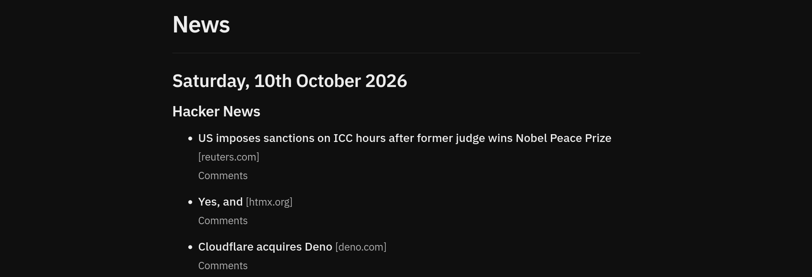

# News

[news.hawksley.dev](https://news.hawksley.dev) is a news aggregator for Hacker News and Lobsters. It updates once each day with new posts, whilst preserving the posts from previous days.



## Features

- Shows the top 10 Hacker News and the top 5 Lobsters posts
- Updates daily
- Permanent archive of previous days, sorted by month
- Lightweight to load
- Dark mode with WCAG AAA contrast.
- No FOUC

## Running Locally

Requires [Node.js 22+](https://nodejs.org) and [pnpm](https://pnpm.io).

```shell
git clone https://github.com/ethanhawksley/news
cd news
pnpm install
pnpm run dev
```

Then open `http://localhost:4321` in your browser.

To fetch the day's posts:

```shell
node scripts/fetch.ts
```

It will output the day's posts into a YYYY-MM-DD.json file in `src/content/days/`

## Background Info

This project was created as a way to prevent me from checking in on Hacker News and Lobsters throughout the day. By having a page that only updates daily, it removes the reason to check more than once a day.

It was created with Astro and Node.js, with some design inspiration from my [personal website](https://hawksley.dev).

## License

[MIT](LICENSE)
